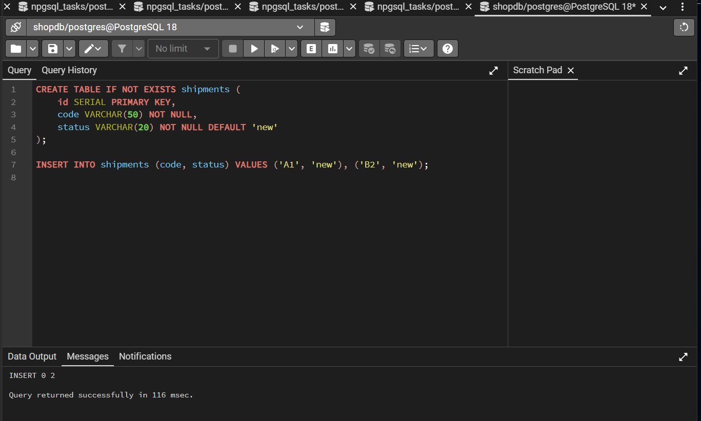
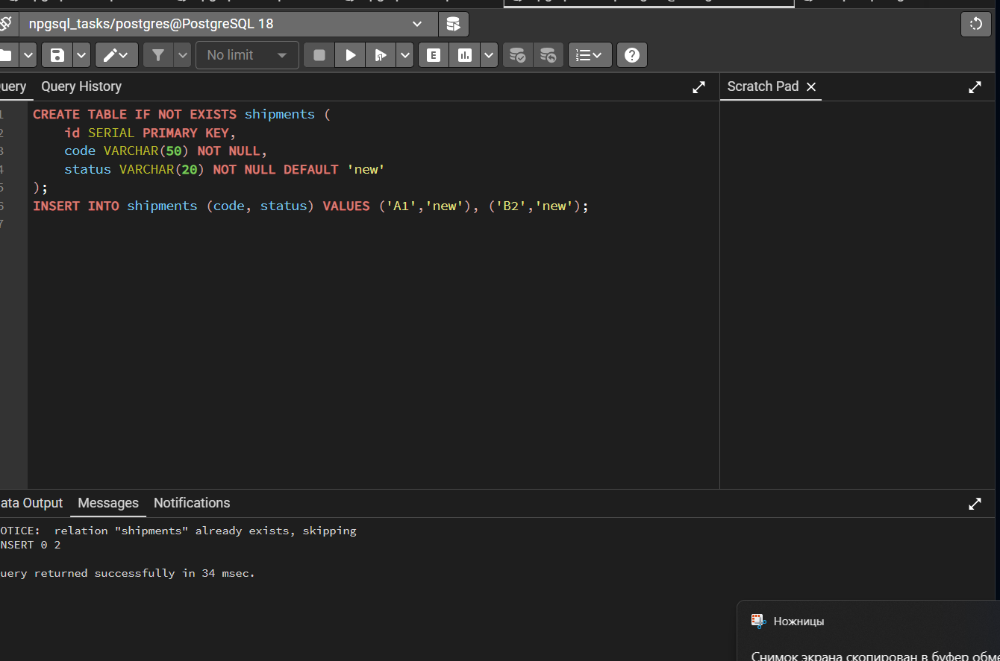
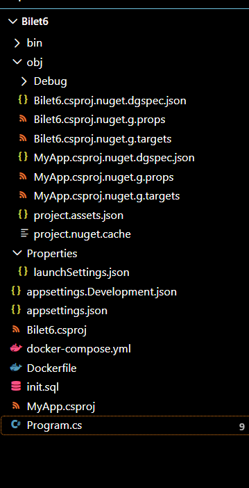
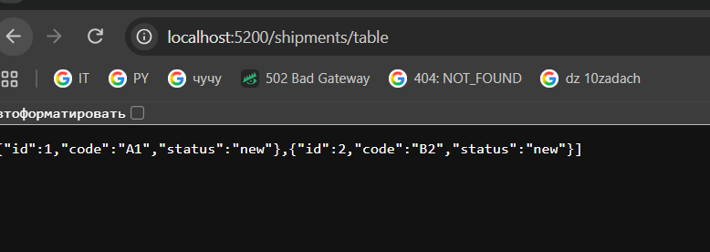
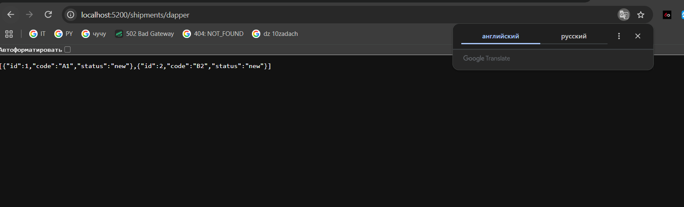
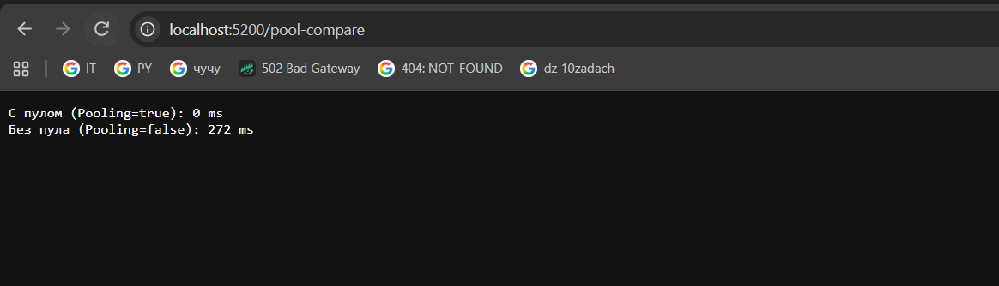
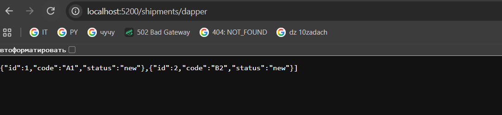

# Билет 6 — Логистика: доставки (ASP.NET Core Minimal API + ADO.NET / Dapper)

Практическое решение экзаменационного билета №6. Приложение разработано на базе **ASP.NET Core Minimal API** и демонстрирует работу с пулом соединений, транзакциями, микро-ORM Dapper и DataSet/DataTable в СУБД **PostgreSQL**.

---

## 📸 Скриншоты выполнения работы

Все этапы развертывания проекта, инициализации базы данных и проверки эндпоинтов:

### 1. Инициализация СУБД и структуры таблиц
*   **Инициализация структуры и первое наполнение данными:**
    
*   **Повторная проверка скрипта (корректный пропуск через IF NOT EXISTS):**
    

### 2. Развертывание и файловая структура
*   **Дерево файлов проекта и конфигурации в IDE Visual Studio Code:**
    

### 3. Проверка работы эндпоинтов веб-сервера
*   **Тестирование пула соединений (`GET /pool-compare`):**  
    С включенным пулом повторные коннекты занимают **0 ms**, без пула — **272 ms**.
    
*   **Выборка данных через Dapper (`GET /shipments/dapper`):**  
    
    
*   **Отчет через автономный уровень ADO.NET (`GET /shipments/table`):**  
    

---

## 🛠 Реализованный функционал

1.  **`GET /pool-compare`** — Сравнение скорости открытия 5 последовательных соединений при включенном и выключенном механизме Connection Pooling.
2.  **`POST /shipments/close?id={id}`** — Обновление статуса доставки на `closed` с использованием транзакций (`NpgsqlTransaction`) для обеспечения атомарности.
3.  **`GET /shipments/dapper`** — Быстрая выборка списка доставок с помощью микро-ORM Dapper.
4.  **`GET /shipments/table`** — Извлечение данных с применением `NpgsqlDataAdapter`, `DataSet` и `DataTable`.

    **Dapper** — это микро-ORM (подключенный уровень), маппит строки из базы напрямую в C# объекты "на лету". **DataSet/DataTable** — это автономный уровень ADO.NET. `DataAdapter` полностью выкачивает данные в оперативную память, после чего соединение закрывается, а мы работаем со слепком данных в кэше.
